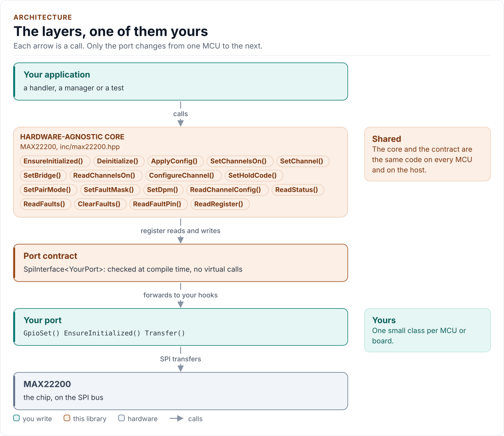

# MAX22200 Driver

C++20 driver for the Analog Devices MAX22200 and MAX22200A octal 36 V, 1 A serial-controlled solenoid and motor drivers.

[](https://github.com/kokeb-labs-drivers/driver-max22200/actions/workflows/ci.yml)
[](LICENSE)
[](docs/installation.md#requirements)

**Documentation: [`docs/`](docs/index.md)**, with the API reference built by Doxygen ([how](docs/api-reference.md)).
The site at <https://kokeb-labs-drivers.github.io/driver-max22200/> opens when the repository is public.


The MAX22200 drives eight solenoids, valves, relays or motor half-bridges from a 4.5 V to 36 V supply, up to 1 A
each, with a HIT current (or duty cycle) to pull a plunger in and a lower HOLD level to keep it there. This driver
starts it with the datasheet's programming procedure, checks that every register holds what it wrote, switches
channels with one 8-bit write and no read (one transfer when the last access was a switch), refuses settings the
chip cannot do safely (a CDR code that means "full on, no regulation", a HIT time that rounds to "forever", a mode
change while a channel runs), and turns the fault flags into data you can act on. It runs on any MCU: you give it a
small class that moves bytes and drives two pins, and it does the rest.

<!-- figure: driver-layers -->
<picture>
  <source media="(prefers-color-scheme: dark)" srcset="docs/diagrams/driver-layers.dark.svg">
  
</picture>
<!-- /figure -->

## At a glance

| | |
| --- | --- |
| **Chip** | MAX22200 or MAX22200A: eight half-bridges, 4.5 V to 36 V, 1 A RMS each, 200 mΩ |
| **Drives** | Current (CDR, 7-bit, IFS set by RREF) or voltage (VDR, 1 % duty) regulation; HIT, HOLD and HIT time per channel; low side, high side, parallel pairs, full bridges |
| **Diagnostics** | Overcurrent, open load, HIT current not reached, plunger movement, overtemperature, undervoltage, SPI clock count; FAULT pin |
| **Bus** | SPI mode 0, up to 10 MHz; a command byte with CMD high, then 8 or 32 bits of data; ENABLE |
| **Driver** | Header-only C++20; no heap, exceptions, RTTI or virtual calls; every call returns `Result<T>` |
| **Runs on** | Any MCU with SPI, two GPIO outputs and a C++20 compiler; the host example runs on any PC ([Platforms](docs/platforms.md)) |
| **Status** | 0.1.0, **not verified on hardware**: host-tested against a protocol model of the chip ([Status and limitations](docs/limitations.md)) |

## Datasheet

<!-- generated: datasheet-card -->
| Document | Revision | Get it |
| --- | --- | --- |
| Datasheet: MAX22200/MAX22200A 36V, 1A Octal Integrated Serial-Controlled Solenoid and Motor Driver (Analog Devices 19-100531) | 1, 2025-03 | [vendor page](https://www.analog.com/en/products/max22200.html) |

Written against these revisions; the SHA-256 of each file is in [`docs/datasheets.yml`](docs/datasheets.yml). Where each
part of the driver is in the datasheet: [Datasheet map](docs/datasheet.md).
<!-- /generated -->

Every docs page lists the datasheet sections it relies on, and code comments cite the section they implement.

## Try it on your PC

No hardware needed: [`examples/host`](examples/host/README.md) runs the driver against a simulated chip.
You need git, CMake 3.16+ and a C++20 compiler (GCC 10+, Clang 13+ or MSVC 2022).

1. Get the source:

   ```bash
   git clone https://github.com/kokeb-labs-drivers/driver-max22200.git && cd driver-max22200
   ```

2. Build and run the example:

   ```bash
   cmake -S examples/host -B build-example
   cmake --build build-example
   ./build-example/max22200_host_example
   ```

3. You should see the driver start the simulated chip, switch two valves and read the diagnostics:

   ```text
   MAX22200 driver 0.1.0 on the host
   max22200: initialised
   HIT 500000 uA for 20800 us, HOLD 148437 uA
   ONCH 0x01, flags 0x00
   faults on channels 0x00
   ```

To run the whole test suite instead: `cmake -S . -B build -DMAX22200_BUILD_TESTS=ON && cmake --build build && ctest
--test-dir build`.

## Use it on your MCU

**1. Wire it** ([Hardware](docs/hardware.md) has every pin, the timing and the power):

| MCU | MAX22200 | Notes |
| --- | --- | --- |
| SPI SCK | SCK | Mode 0, up to 10 MHz; 1 MHz for bring-up on jumper wires |
| SPI MOSI | SDI | |
| SPI MISO | SDO | Open drain: a pull-up is required (1 kΩ to 4.7 kΩ) |
| GPIO (chip select) | CSB | Low for each transfer |
| GPIO | CMD | High while the command byte is written |
| GPIO | ENABLE | Or tie it high; it has a 1.5 MΩ pull-down |
| GPIO input (optional) | FAULT | Open drain, active low |
| | IREF | RREF to ground, 15 kΩ to 100 kΩ: IFS = 15 kΩ x 1 A / RREF |
| 4.5 V to 36 V | VM | The load supply; 0.1 µF at each VM pair and 10 µF bulk |

**2. Write the port**: a class with `EnsureInitialized()`, `Transfer()` (1 or 4 bytes with CSB low), `GpioSet()`
(CMD and ENABLE) and `DelayUs()`, about 30 lines on most SDKs. [Porting](docs/porting.md) has the contract and a
complete example.

**3. Drive a valve:**

<!-- generated: quickstart-code -->
```cpp
#include "max22200.hpp"

int open_valve_0(MyPort& port) {
  max22200::Config cfg{};
  cfg.rref_ohm = 15000; // IFS = 15k x 1 V / 15 kohm = 1 A
  max22200::ChannelConfig& v = cfg.channels[0];
  v.hit = max22200::CurrentCode(600, cfg.rref_ohm, false).value;      // 600 mA peak to pull in
  v.hold = max22200::CurrentCode(200, cfg.rref_ohm, false).value;     // 200 mA to hold
  v.hit_time = max22200::HitTimeCode(30000, cfg.clock, v.chop).value; // 30 ms of HIT

  static max22200::MAX22200<MyPort> chip(port, cfg); // no I/O yet
  if (auto r = chip.EnsureInitialized(); !r) { // ENABLE, Figure 6, read-back of every register
    return static_cast<int>(r.error);          // NoDevice, DeviceIdMismatch: check the wiring
  }
  if (auto r = chip.SetChannel(0, true); !r) { // one 8-bit write: 2 transfers, then 1 per switch
    return static_cast<int>(r.error);
  }
  return 0; // HIT for 30 ms, then HOLD until SetChannel(0, false)
}
```
<!-- /generated -->

`EnsureInitialized()` is the only call that starts the chip. Every other call returns `Error::NotInitialized`
until it has succeeded, and no read ever starts the chip on its own.

## What it does

- Starts the chip with the programming procedure of the datasheet (ENABLE, tEN, STATUS, every channel, tWU) and
  reads every register back before it reports success; it clears and reports faults latched before the start, so
  the FAULT pin shows new ones only; nothing touches the chip before `EnsureInitialized()`.
- Switches channels with one 8-bit write from its own copy of ONCH: no STATUS read, which would cost two transfers
  and clear the OVT and UVM flags. The command stays in force (p25), so a switch right after a switch is one
  transfer, and the STATUS[7:0] byte it returns keeps fault monitoring free.
- Converts milliamps and microseconds to the chip's codes exactly (IFS / 128 per step, 40 chopping periods per HIT
  step) and refuses what would round into a dangerous code.
- Reads and clears the FAULT register the way the fitted part does it: the default suits both parts; a selective
  clear needs the MAX22200A declared (check the BOM).
- Keeps every clear-on-read flag its reads take from the chip (OVT, UVM, the FAULT flags) in a latch you read and
  clear without I/O, and offers a single-shot raw register read for bring-up.
- Offers a read-back per call (`Verify::ReadBack`) where a lost frame matters, at a stated cost in transfers.
- Returns `Result<T>` with an `Error` from every call: no exceptions, no heap, no RTTI, no virtual calls.

## Add it to your project

Pick the row that matches your build; each is a few steps, and [Installation](docs/installation.md) has the
details.

| Your build | Steps below |
| --- | --- |
| Plain CMake: STM32 (CubeMX), RP2040 (Pico SDK), nRF Connect, a host app | [A](#a-cmake-any-mcu) |
| ESP-IDF | [B](#b-esp-idf) |
| An SDK or OS image that installs libraries | [C](#c-installed-package) |

### A. CMake, any MCU

1. Add the driver as a submodule, pinned to the version you chose:

   ```bash
   git submodule add https://github.com/kokeb-labs-drivers/driver-max22200.git external/driver-max22200
   ```

2. In your `CMakeLists.txt`, after `project()`:

   ```cmake
   add_subdirectory(external/driver-max22200)
   target_link_libraries(my_app PRIVATE max22200::max22200)   # brings the headers and C++20
   ```

3. In your code, `#include "max22200.hpp"`, write the port ([Porting](docs/porting.md)) and build. A first build
   that compiles the quickstart above is the check that the driver is wired in.

### B. ESP-IDF

1. Add the driver under your project's `components/`; ESP-IDF finds it there and names it after the folder:

   ```bash
   git submodule add https://github.com/kokeb-labs-drivers/driver-max22200.git components/max22200
   ```

2. In `main/CMakeLists.txt`, list it: `idf_component_register(SRCS "main.cpp" REQUIRES max22200)`.
3. `idf.py menuconfig` now has a **MAX22200 solenoid driver** menu (fitted part, oscillator, RREF),
   and `idf.py build` builds the driver with your app. [`examples/esp32`](examples/esp32) is a complete
   project with a port for the board.

### C. Installed package

1. Install it once into a prefix:

   ```bash
   cmake -S external/driver-max22200 -B build-max22200 && cmake --install build-max22200 --prefix /opt/sdk
   ```

2. In your project, with `CMAKE_PREFIX_PATH=/opt/sdk`:

   ```cmake
   find_package(max22200 0.1 REQUIRED)
   target_link_libraries(my_app PRIVATE max22200::max22200)
   ```

The target is `max22200::max22200` every way, so switching later changes nothing else.

## Documentation

| Page | Read it when you want to |
| --- | --- |
| [Quickstart](docs/quickstart.md) | Go from a bare chip to a valve that opens on your MCU |
| [Hardware](docs/hardware.md) | Wire it, check the bus settings, the timing and the power |
| [Porting](docs/porting.md) | Write the port class for your MCU's SDK |
| [API guide](docs/api-guide.md) | Use each call: start, switch, configure, read faults, handle errors |
| [Drive modes](docs/drive-modes.md) | Choose CDR or VDR, HIT and HOLD, the chopping frequency, bridges and DPM |
| [Configuration](docs/configuration.md) | Choose every setting |
| [Status and limitations](docs/limitations.md) | Know what is and is not verified, and the datasheet findings |
| [Troubleshooting](docs/troubleshooting.md) | Find the cause of an error or a wrong reading |
| [Contract](docs/contract.md) | Know exactly what the driver promises, needs and returns |
| [Datasheet map](docs/datasheet.md) | Find the datasheet section behind each part of the driver |
| [API reference](docs/api-reference.md) | Look up a class or member (Doxygen; built by CI and locally) |

## Tests and quality

```bash
cmake -S . -B build -DMAX22200_BUILD_TESTS=ON && cmake --build build && ctest --test-dir build
```

The host tests run the driver against a protocol model of the chip, fail every bus transfer and pin write in turn,
and produce each error the driver can return. A fuzzer fails, corrupts and replaces what the chip sends back and
checks the driver's promises after every call. CI also builds for Cortex-M and gates coverage, complexity, sanitizers,
fuzzing, clang-tidy, cppcheck and the handbook rules (`.kokeb/handbook.yml`). See [Testing and CI](docs/testing.md),
which lists every gate and its limit.

## License

MIT. See [LICENSE](LICENSE).
