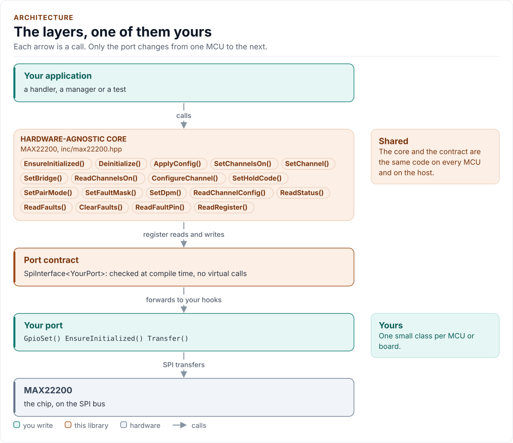
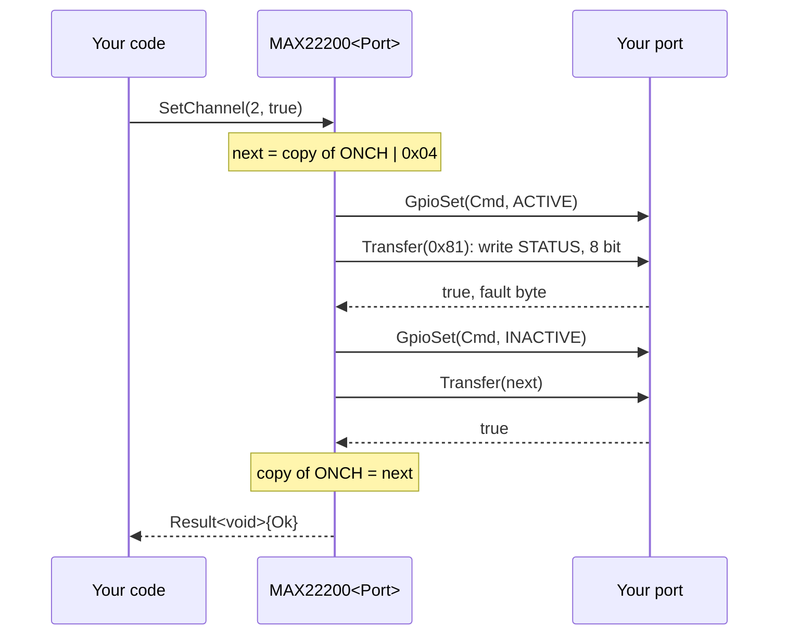

# Architecture

How the driver is built: three layers, one of them yours, the two-phase access every call is made of, and the
copy of the chip's registers the driver keeps.

<!-- generated: datasheet-refs -->
??? abstract "Datasheet sections this page relies on"

    From Analog Devices 19-100531 1:

    - The SPI, the 8-bit accesses and the daisy chain: SPI Detailed Description; Figure 5, p. 23
    - The programming procedure: Programming Procedure; Figure 6, p. 23
    - The Command Register and the fault byte: Command Register Description (COMMAND); Table 9; Figure 7, p. 25
    - 32-bit and 8-bit transfers and the command echo: Reading and Writing Operations of Registers; Figures 10 to 13, p. 30
    - Register map and reset values: Register Map; Register Details, p. 35

    All of them, with the driver API for each: [Datasheet map](datasheet.md).
<!-- /generated -->

<!-- figure: driver-layers -->
<picture>
  <source media="(prefers-color-scheme: dark)" srcset="diagrams/driver-layers.dark.svg">
  
</picture>
<!-- /figure -->

## Layers

| Layer | Files | Owns |
| --- | --- | --- |
| Core | [`inc/max22200.hpp`](../inc/max22200.hpp), [`src/max22200.ipp`](../src/max22200.ipp) | Lifecycle, the programming procedure, the register copy, the checks, errors |
| Types and registers | [`inc/max22200_types.hpp`](../inc/max22200_types.hpp), [`inc/max22200_registers.hpp`](../inc/max22200_registers.hpp) | `Error`, `Result<T>`, `Config`, the encodings, the unit conversions, `Validate()`; the register map |
| Port contract | [`inc/max22200_spi_interface.hpp`](../inc/max22200_spi_interface.hpp) | The CRTP base, `CtrlPin` and `GpioSignal`, the `SpiPort` concept, the two-phase access |
| Platform port | Your class | Bus bring-up, byte transfers, CMD and ENABLE, the delay; optionally the FAULT pin and logging |
| Kconfig layer | [`inc/max22200_kconfig.hpp`](../inc/max22200_kconfig.hpp) | Optional: a `Config` from ESP-IDF menuconfig |

## One access, two transfers

The chip has one 8-bit Command Register and four kinds of 32-bit register: STATUS, CFG_CH0 to CFG_CH7, FAULT and
CFG_DPM. Every access is two SPI transfers ("Command Register Description", Figures 7 and 10 to 13):

| Transfer | CMD | SDI | SDO |
| --- | --- | --- | --- |
| 1. Command | high, also at the CSB rising edge | RB/W, A_BNK (bank), 8bit/n32bits | STATUS[7:0], the fault byte |
| 2a. Write 32 bits | low | DATAIN[7:0], [15:8], [23:16], [31:24]: LSB byte first | STATUS[7:0], the command, 0, 0 |
| 2b. Read 32 bits | low | 0 (FAULT: the flags to clear, LSB byte first) | DATA[31:24], [23:16], [15:8], [7:0]: MSB byte first |
| 2c. Write 8 bits | low | DATAIN[31:24] | STATUS[7:0] |
| 2d. Read 8 bits | low | | DATA[31:24] |

`detail::RegisterBus` does this and nothing else. It drives CMD high only if the port can (a command sent with CMD
low would be taken as data), and drives it low again after every command byte. The fault byte of every command is
kept (`GetLastStatusByte()`); the command echo of a 32-bit write is checked at start-up and with
`Verify::ReadBack`.

The 8-bit accesses are the fast paths the datasheet names: ONCH (switching, `SetChannelsOn()`) and HFS/HOLD
(`SetHoldCode()`), one byte each.

## One call through the layers

## The register copy

The driver keeps what it wrote: the `Config` (STATUS fields, every CFG_CHn, CFG_DPM) and ONCH. It needs the copy
because:

- STATUS holds ONCH and the configuration together, so a 32-bit STATUS write (a pair mode, the masks) must carry the
  current ONCH, and a single-channel switch must know the other seven without reading STATUS. A read would cost two
  transfers and clear OVT and UVM as a side effect (every STATUS read the driver does make keeps them in the latch
  of `GetLatchedFaults()`).
- The chip ignores a drive-mode or side change while a channel is on, and a pair-mode change while one of the pair is
  on; the driver refuses them up front (`ChannelsActive`) from the copy. After a failed ONCH write the channels it
  would have changed count as on for this check, because the chip may have taken the write.
- The 8-bit HOLD write must carry the channel's HFS bit.

The copy is what the driver wrote, not what the chip holds: `ReadStatus()`, `ReadChannelsOn()`,
`ReadChannelConfig()` and `Verify::ReadBack` read the chip.

## Design choices

- **CRTP, not virtual functions.** The port is a template parameter constrained by the `SpiPort` concept, so every
  call is resolved at compile time and a missing hook is a compile error that names it.
- **Required pins in the port.** CMD is part of the protocol, so `GpioSet()` is required and must return `bool`; a
  failed pin write is reported as `Pin`, never ignored.
- **Optional hooks by `requires`.** `GpioRead` (the FAULT pin) and `Log` are detected with C++20 `requires` in one
  place; without them `ReadFaultPin()` returns `Unsupported` and nothing is logged.
- **Codes, not floats, in the configuration.** `ChannelConfig` holds the register's codes; the conversions from
  milliamps and microseconds are exact integer functions that refuse a value the chip cannot do safely.
- **No I/O in the constructor.** Construction cannot fail, so the driver can be a static or a member of a handler.
- **One error type.** `Result<T>` carries a value and an `Error`; nothing throws and nothing returns a bare `bool`.
- **No heap, no exceptions, no RTTI, no `std::function`, no `printf`.** The driver is a header-only template with no
  mutable static state.

## Source map

| You want | Read |
| --- | --- |
| The public API | [`inc/max22200.hpp`](../inc/max22200.hpp) |
| How a call is implemented | [`src/max22200.ipp`](../src/max22200.ipp) |
| Register banks, bits and timing | [`inc/max22200_registers.hpp`](../inc/max22200_registers.hpp) |
| The settings, encodings and conversions | [`inc/max22200_types.hpp`](../inc/max22200_types.hpp) |
| The port contract and the two-phase access | [`inc/max22200_spi_interface.hpp`](../inc/max22200_spi_interface.hpp) |

Next: [Contract](contract.md).
