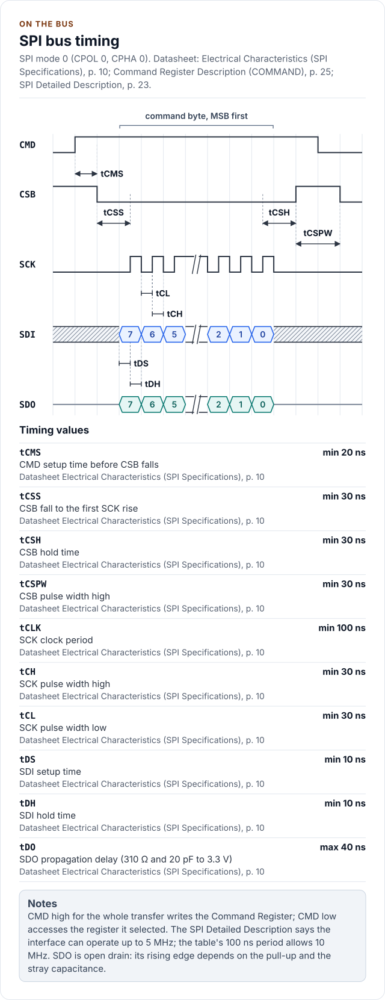
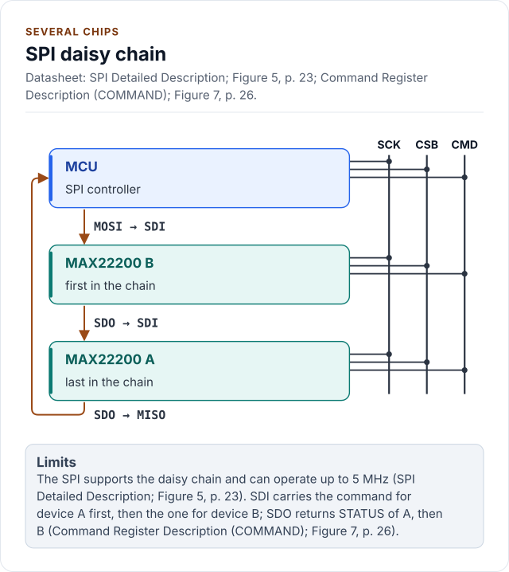

# On the bus

What the MAX22200 needs from the SPI bus, signal by signal, with every time and rate taken from the datasheet. The
register transfers are on the [Hardware](hardware.md) and [Architecture](architecture.md) pages; this page is the
waveform under them.

## SPI timing

The MAX22200 uses SPI mode 0: SCK idles low, SDI is read on the rising edge and SDO, an open-drain output, shifts out
on the falling edge, MSB first. A fifth line, CMD, tells the chip what a transfer is: high for a write of the 8-bit
Command Register, low for the 8-bit or 32-bit access to the register that command selected.

<!-- figure: spi-timing -->
<picture>
  <source media="(prefers-color-scheme: dark)" srcset="diagrams/spi-timing.dark.svg">
  
</picture>
<!-- /figure -->

## Several devices

The datasheet describes a daisy chain (Figure 5): SDO of one chip feeds SDI of the next, SCK, CSB and CMD are shared,
and one CSB low phase carries one byte or word per chip. This driver talks to one chip per object and does not
support the chain ([Limitations](limitations.md)).

<!-- figure: spi-chain -->
<picture>
  <source media="(prefers-color-scheme: dark)" srcset="diagrams/spi-chain.dark.svg">
  
</picture>
<!-- /figure -->

## How these figures are made

Each figure is a model in `docs/model/` (`spi-timing.timing.yml` and `spi-chain.topology.yml`) that cites the
datasheet section and page of every number; `kokeb-docs figures` draws it and the build fails on a number without a
citation. The values table under the waveform is also written as `docs/diagrams/spi-timing.table.html`.
