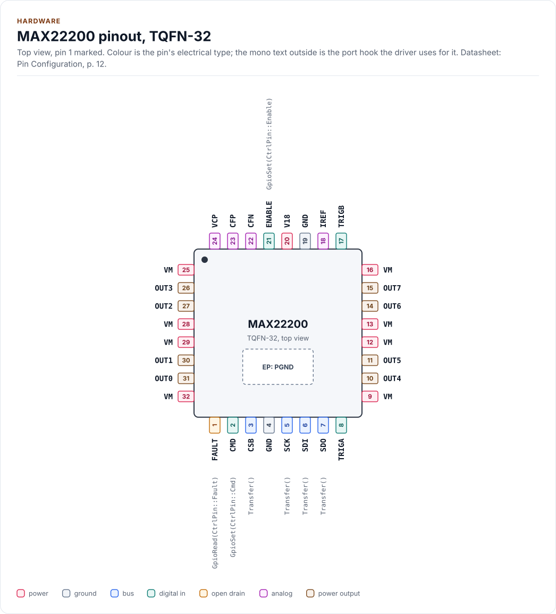
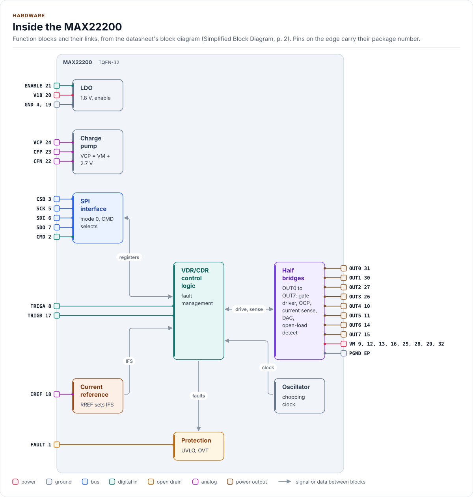
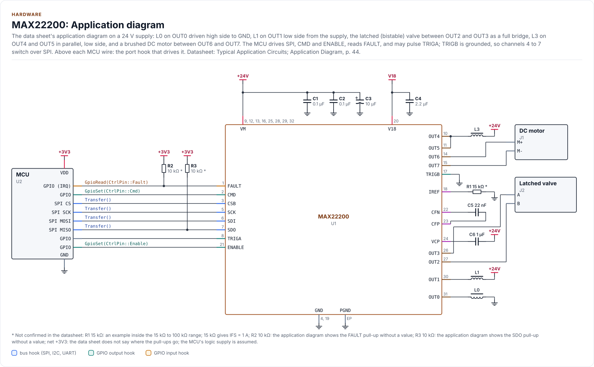

# Hardware

The MAX22200's pins, bus settings, timing and power, as the driver uses them. Everything here is from the
datasheet; nothing on this page is **verified on hardware** with this driver yet ([Status and
limitations](limitations.md)).

<!-- generated: datasheet-refs -->
??? abstract "Datasheet sections this page relies on"

    From Analog Devices 19-100531 1:

    - The two parts and how each clears the FAULT register: General Description; Ordering Information, p. 1
    - Supply, logic levels, on-resistance, OCP and open-load thresholds: Absolute Maximum Ratings; Electrical Characteristics, p. 7
    - Full-scale current constant KFS and the CDR accuracy: Electrical Characteristics (KFS0, KFS1, ITRERR), p. 9
    - Enable, wake-up and disable times; SPI timing: Electrical Characteristics (tEN, tWU, tDIS, SPI); Figure 1, p. 10
    - Pins, CMD, ENABLE, FAULT and the TRIG inputs: Pin Configuration; Pin Description, p. 12
    - Current rating and safe operating area: Applications Information; Current Rating; Figures 14 to 17, p. 42
    - The application diagram: Typical Application Circuits; Application Diagram, p. 44

    All of them, with the driver API for each: [Datasheet map](datasheet.md).
<!-- /generated -->

## Parts

| Part | FAULT register | Driver setting |
| --- | --- | --- |
| MAX22200A | Selective clear on read: a read clears only the flags whose SDI bit is high | `Config::variant = Variant::Max22200A` |
| MAX22200 | Every read clears every flag; a fault that arrives during the read is lost | `Config::variant = Variant::Max22200` (the default) |

The two parts are otherwise the same ("Clearing the FAULT Register", Ordering Information). The chip cannot tell
which it is, so the variant is configured; the datasheet recommends the MAX22200A for new designs. The default,
`Max22200`, is correct on both: it never asks for a selective clear, and `ClearFaults()` sends all ones. Declare
`Max22200A` only when the bill of materials names it and a bench check shows a zero-SDI read leaves a latched flag
set ([bench steps 5 and 11](limitations.md#before-you-depend-on-it)): a selective clear
sent to a MAX22200 clears every flag. The selective clear's SDI byte order follows Figure 8 (LSB byte first), one
constant (`reg::kFaultClearLsbByteFirst`), **not verified on hardware**.

## Pins

The 32-pin TQFN as the Pin Configuration draws it, from the top: pin 1 at the bottom left, the exposed pad (power
ground) underneath.

<!-- figure: chip-pinout -->
<picture>
  <source media="(prefers-color-scheme: dark)" srcset="diagrams/chip-pinout.dark.svg">
  
</picture>
<!-- /figure -->

<!-- generated: chip-pins -->
TQFN-32, 32 pins and an exposed pad (Pin Configuration, p. 12).

| Pin | Name | Type (domain) | Function | Driver hook | If unused | Datasheet |
| --- | --- | --- | --- | --- | --- | --- |
| 1 | `FAULT` | open drain (logic) | Fault output, low while an unmasked fault is present; needs a pull-up | `GpioRead(CtrlPin::Fault)` | Leave open | Pin Description, p. 12 |
| 2 | `CMD` | digital in (logic) | High to write the Command Register, low for every other register; pull-down | `GpioSet(CtrlPin::Cmd)` | - | Pin Description, p. 12 |
| 3 | `CSB` | bus (logic) | SPI chip select, active low; pull-up current | `Transfer()` | - | Pin Description, p. 12 |
| 4 | `GND` | ground | Signal ground | - | - | Pin Description, p. 12 |
| 5 | `SCK` | bus (logic) | SPI clock, up to 10 MHz; pull-down | `Transfer()` | - | Electrical Characteristics (SPI); Figure 1, p. 10 |
| 6 | `SDI` | bus (logic) | SPI data in (MOSI); pull-down | `Transfer()` | - | Pin Description, p. 12 |
| 7 | `SDO` | bus (logic) | SPI data out (MISO), open drain; needs a pull-up | `Transfer()` | - | Pin Description, p. 12 |
| 8 | `TRIGA` | digital in (logic) | Trigger input of channels 0, 2, 4 and 6; pull-down | - | Connect to GND | Pin Description, p. 12 |
| 9 | `VM` | power (VM) | Supply, 4.5 V to 36 V | - | - | Electrical Characteristics (Supply Voltage), p. 7 |
| 10 | `OUT4` | power output (VM) | Half-bridge output, channel 4 | - | Leave open | Pin Description (continued), p. 13 |
| 11 | `OUT5` | power output (VM) | Half-bridge output, channel 5 | - | Leave open | Pin Description (continued), p. 13 |
| 12 | `VM` | power (VM) | Supply; 0.1 µF ceramic at pins 12 and 13 | - | - | Pin Description, p. 12 |
| 13 | `VM` | power (VM) | Supply; 0.1 µF ceramic at pins 12 and 13 | - | - | Pin Description, p. 12 |
| 14 | `OUT6` | power output (VM) | Half-bridge output, channel 6 | - | Leave open | Pin Description (continued), p. 13 |
| 15 | `OUT7` | power output (VM) | Half-bridge output, channel 7 | - | Leave open | Pin Description (continued), p. 13 |
| 16 | `VM` | power (VM) | Supply | - | - | Pin Description, p. 12 |
| 17 | `TRIGB` | digital in (logic) | Trigger input of channels 1, 3, 5 and 7; pull-down | - | Connect to GND | Pin Description, p. 12 |
| 18 | `IREF` | analog (V18) | 15 kΩ to 100 kΩ to GND sets the full-scale current of every CDR channel | - | - | Pin Description (continued), p. 13 |
| 19 | `GND` | ground | Signal ground | - | - | Pin Description, p. 12 |
| 20 | `V18` | power (V18) | 1.8 V LDO output; 2.2 µF ceramic to GND, no load | - | - | Pin Description (continued), p. 13 |
| 21 | `ENABLE` | digital in (logic) | High: on; low: sleep. 1.5 MΩ pull-down; tolerates VM | `GpioSet(CtrlPin::Enable)` | - | Enable Logic Input, p. 14 |
| 22 | `CFN` | analog (VM) | Charge pump, 22 nF VM-rated ceramic to CFP | - | - | Pin Description (continued), p. 13 |
| 23 | `CFP` | analog (VM) | Charge pump, 22 nF VM-rated ceramic to CFN | - | - | Pin Description (continued), p. 13 |
| 24 | `VCP` | analog (VM) | Charge-pump output, 1 µF (5 V or more) to VM | - | - | Pin Description (continued), p. 13 |
| 25 | `VM` | power (VM) | Supply | - | - | Pin Description, p. 12 |
| 26 | `OUT3` | power output (VM) | Half-bridge output, channel 3 | - | Leave open | Pin Description (continued), p. 13 |
| 27 | `OUT2` | power output (VM) | Half-bridge output, channel 2 | - | Leave open | Pin Description (continued), p. 13 |
| 28 | `VM` | power (VM) | Supply; 0.1 µF ceramic at pins 28 and 29 | - | - | Pin Description, p. 12 |
| 29 | `VM` | power (VM) | Supply; 0.1 µF ceramic at pins 28 and 29 | - | - | Pin Description, p. 12 |
| 30 | `OUT1` | power output (VM) | Half-bridge output, channel 1 | - | Leave open | Pin Description (continued), p. 13 |
| 31 | `OUT0` | power output (VM) | Half-bridge output, channel 0 | - | Leave open | Pin Description (continued), p. 13 |
| 32 | `VM` | power (VM) | Supply | - | - | Pin Description, p. 12 |
| EP | `PGND` | ground | Exposed pad: power ground and heat path; solder to the ground plane | - | - | Pin Description (continued), p. 13 |

Source of this table and of the chip figures: [`docs/hardware.yml`](hardware.yml).
<!-- /generated -->

The eight VM pins are one supply: bypass them with two 0.1 µF ceramics, one at pins 12 and 13 and one at pins 28
and 29, plus 10 µF bulk. TRIGA switches the even channels and TRIGB the odd ones when a channel is set to its
trigger pin (`trigger_pin`); the driver never drives them. SDO and FAULT are open drain: fit a pull-up to the MCU's
logic supply. The pinout, the block diagram, the circuit and both tables are drawn from
[`docs/hardware.yml`](hardware.yml).

## Inside the chip

The Simplified Block Diagram: the SPI interface feeds the VDR/CDR control logic, which drives the eight half bridges
and reads back their current sense and open-load detectors; the LDO, the charge pump, the oscillator and the current
reference set up its supplies, clock and full-scale current.

<!-- figure: chip-blocks -->
<picture>
  <source media="(prefers-color-scheme: dark)" srcset="diagrams/chip-blocks.dark.svg">
  
</picture>
<!-- /figure -->

## Application circuit

The Application Diagram, with the parts the Pin Description gives for each pin. One chip drives every load the
half bridges support: a high-side solenoid, a low-side solenoid, a latched valve as a full bridge, two outputs in
parallel and a brushed DC motor. The diagram has no flyback diodes: when the low-side FET turns off, the high-side
FET of the same half bridge turns on and the coil current decays through it (Fixed-Frequency Current Control).
TRIGB is grounded; TRIGA is optional.

<!-- figure: chip-circuit-typical -->
<picture>
  <source media="(prefers-color-scheme: dark)" srcset="diagrams/chip-circuit-typical.dark.svg">
  
</picture>
<!-- /figure -->

<!-- generated: chip-parts -->
| Part | Kind | Value | Connects | Datasheet |
| --- | --- | --- | --- | --- |
| U2 | MCU | - | GND: GND, VDD: +3V3, SCK: SCK, MOSI: SDI, MISO: SDO, CS: CSB, CMD: CMD, EN: ENABLE, FLT: FAULT, TRIG: TRIGA | Typical Application Circuits; Application Diagram, p. 44 |
| C1 | capacitor | 0.1 µF | +24V, GND | Pin Description, p. 12 |
| C2 | capacitor | 0.1 µF | +24V, GND | Pin Description, p. 12 |
| C3 | polarized capacitor | 10 µF | +24V, GND | Pin Description, p. 12 |
| C4 | capacitor | 2.2 µF | GND, V18 | Pin Description (continued), p. 13 |
| C5 | capacitor | 22 nF | CP, CN | Pin Description (continued), p. 13 |
| C6 | capacitor | 1 µF | +24V, VCP | Pin Description (continued), p. 13 |
| R1 | resistor | 15 kΩ (not confirmed: an example inside the 15 kΩ to 100 kΩ range; 15 kΩ gives IFS = 1 A) | GND, IREF | Full-Scale Current Setting (IFS), p. 18 |
| R2 | resistor | 10 kΩ (not confirmed: the application diagram shows the FAULT pull-up without a value) | +3V3, FAULT | Typical Application Circuits; Application Diagram, p. 44 |
| R3 | resistor | 10 kΩ (not confirmed: the application diagram shows the SDO pull-up without a value) | +3V3, SDO | Typical Application Circuits; Application Diagram, p. 44 |
| L0 | solenoid | - | GND, OUT0 | Typical Application Circuits; Application Diagram, p. 44 |
| L1 | solenoid | - | +24V, OUT1 | Typical Application Circuits; Application Diagram, p. 44 |
| L3 | solenoid | - | +24V, OUT45 | Typical Application Circuits; Application Diagram, p. 44 |
| J1 | DC motor | - | 1: OUT6, 2: OUT7 | Typical Application Circuits; Application Diagram, p. 44 |
| J2 | Latched valve | - | 2: OUT2, 1: OUT3 | Typical Application Circuits; Application Diagram, p. 44 |

Export a circuit for a schematic or PCB tool: `kokeb-docs hardware --kicad-netlist OUT.net --circuit typical`.
<!-- /generated -->

## Control pins

| Pin | `CtrlPin` | Who drives it | The driver |
| --- | --- | --- | --- |
| CMD | `CtrlPin::Cmd` | Your port's `GpioSet()`, required | High for each command byte, low for the data and between accesses |
| ENABLE | `CtrlPin::Enable` | Your port's `GpioSet()`, required (return `true` if it is tied high) | High in `EnsureInitialized()`, low in `Deinitialize()` and after a failed start |
| FAULT | `CtrlPin::Fault` | Your port's `GpioRead()`, optional | Read by `ReadFaultPin()` only |
| TRIGA, TRIGB | none | Your application | Never; see the note under [Timing](#timing) |

`GpioSignal::ACTIVE` is the pin's function asserted: CMD and ENABLE high, FAULT low. The port maps it to the
level.

## Bus settings

| Setting | Value | Source |
| --- | --- | --- |
| SPI mode | 0 (CPOL = 0, CPHA = 0), MSB first | "SPI Detailed Description" |
| Clock | Up to 10 MHz (tCLK 100 ns, tCH and tCL 30 ns) | Electrical Characteristics, Figure 1 |
| CSB | Low for one transfer (1 or 4 bytes), high 30 ns at least between transfers | Figure 1 |
| CMD | Set at least 20 ns (tCMS) before the CSB falling edge of a command byte, held (tCMH, no value given) after CSB rises; high at the CSB rising edge (p26) | Figure 1, p26 |
| SDO | Valid 40 ns after the falling SCK edge into 310 Ω and 20 pF; the pull-up's RC limits the rate | Electrical Characteristics, note 2 |
| Daisy chain | Not supported by this driver (5 MHz in a chain) | Figure 5 |

The driver sends a command byte with CMD high, then the data with CMD low: 4 bytes for a 32-bit access (LSB byte first
when writing, MSB byte first when reading), 1 byte for an 8-bit access of bits 31:24. CMD idles high: it goes low only
for a data phase and back high right after, so a stray clock is never taken as data. See
[Architecture](architecture.md#one-access-two-transfers).

## Timing

| Symbol | Value | Where the driver waits |
| --- | --- | --- |
| tEN | 0.5 ms max, ENABLE rising to SPI ready | `EnsureInitialized()`, after ENABLE goes high (`reg::kEnableUs`) |
| tWU | 2.5 ms max, ACTIVE = 1 to the outputs active | `EnsureInitialized()`, after each ACTIVE write of the wake loop (`reg::kWakeUpUs`), every `kWakePollUs` up to `Config::wake_timeout_us` |
| tDIS | 2.5 ms max, ENABLE falling to the outputs Hi-Z | Not waited: `Deinitialize()` writes ACTIVE = 0 first, which puts the outputs Hi-Z |
| tOCP | 1.2 µs typ (doubled with SRC) | Chip-internal |
| tOL | 200 µs typ, open-load deglitch | Chip-internal |

`EnsureInitialized()` blocks for at least tEN + tWU (3 ms), longer while UVM stays set. VDRnCDR and HSnLS change
only while every channel is off **and TRIGA and TRIGB are low** (Programming Procedure, step 5c). The driver checks
the channels it switched (`ChannelsActive`) but cannot see the TRIG pins: keep them low while you change a drive
mode or a side, or use `Verify::ReadBack`, which reports a change the chip ignored.

## Power

| Supply | Range | Notes |
| --- | --- | --- |
| VM | 4.5 V to 36 V (40 V absolute) | UVLO at 4 V typ rising (3.75 V to 4.25 V), 0.12 V hysteresis |
| Logic inputs | 6 V absolute maximum; high above 1.2 V, low below 0.65 V | 3.3 V and 1.8 V MCUs both work |
| ENABLE | High above 0.9 V, up to VM | |

| State | Current from VM |
| --- | --- |
| ENABLE low | 11 µA max |
| ACTIVE = 0 | 200 µA typ, 400 µA max |
| Every channel off (VDR) | 2.5 mA typ |
| Every channel on, CDR, no load | 5.2 mA typ |

Below UVLO every channel is Hi-Z and the charge pump stops; the registers survive until V18 falls below the
power-on reset threshold, after which every register is back at its reset value and the next call returns
`DeviceReset` without writing to the chip ("Undervoltage Lockout (UVLO)").

## Current and heat

The OCP threshold is 1.1 A minimum; in CDR the regulation loop limits the current. Do not exceed 1 A RMS per
channel, and keep the junction below 125 °C: the safe operating area depends on the board, the supply, the number of
channels on, the chopping frequency and SRC (Current Rating, Figures 14 to 17). Thermal shutdown at 145 °C turns
every output off; they come back by themselves when the die cools, with the OVT flag set until STATUS is read.

## Full-scale current

IFS = KFS x 1 V / RREF, with KFS = 15 000 (HFS = 0) or 7 500 (HFS = 1). RREF from 15 kΩ to 100 kΩ gives IFS from
1 A down to 150 mA (HFS halves it). Declare RREF in `Config::rref_ohm` to use the milliamp conversions
([Drive modes](drive-modes.md#current-drive-cdr)). The CDR accuracy is ±6 % from 71 % to 100 % of IFS, ±10 % from
20 % to 70 %, ±15 % from 10 % to 20 % and ±25 % from 5 % to 10 %, with a 1 % RREF: use HFS for small currents.

## Reference documents

The datasheet: [MAX22200 product page](https://www.analog.com/en/products/max22200.html). Every pin, setting and
timing on this page cites a section of it; its revision, its SHA-256 and the sections each page relies on are in
[`docs/datasheets.yml`](datasheets.yml).

<!-- generated: datasheet-card -->
| Document | Revision | Get it |
| --- | --- | --- |
| Datasheet: MAX22200/MAX22200A 36V, 1A Octal Integrated Serial-Controlled Solenoid and Motor Driver (Analog Devices 19-100531) | 1, 2025-03 | [vendor page](https://www.analog.com/en/products/max22200.html) |

Written against these revisions; the SHA-256 of each file is in [`docs/datasheets.yml`](datasheets.yml). Where each part
of the driver is in the datasheet: [Datasheet map](datasheet.md).
<!-- /generated -->

| Also useful | Contents |
| --- | --- |
| [`inc/max22200_registers.hpp`](../inc/max22200_registers.hpp) | The register map as the driver uses it, with datasheet section names |
| [Application diagram](https://www.analog.com/en/products/max22200.html) | Datasheet p. 44: high side, low side, a latched valve, a parallel pair and a DC motor on one chip |
