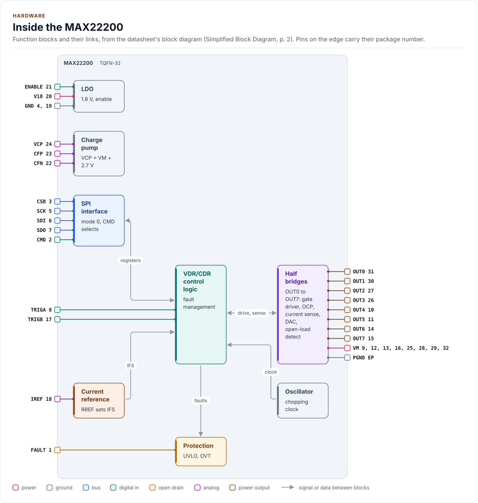
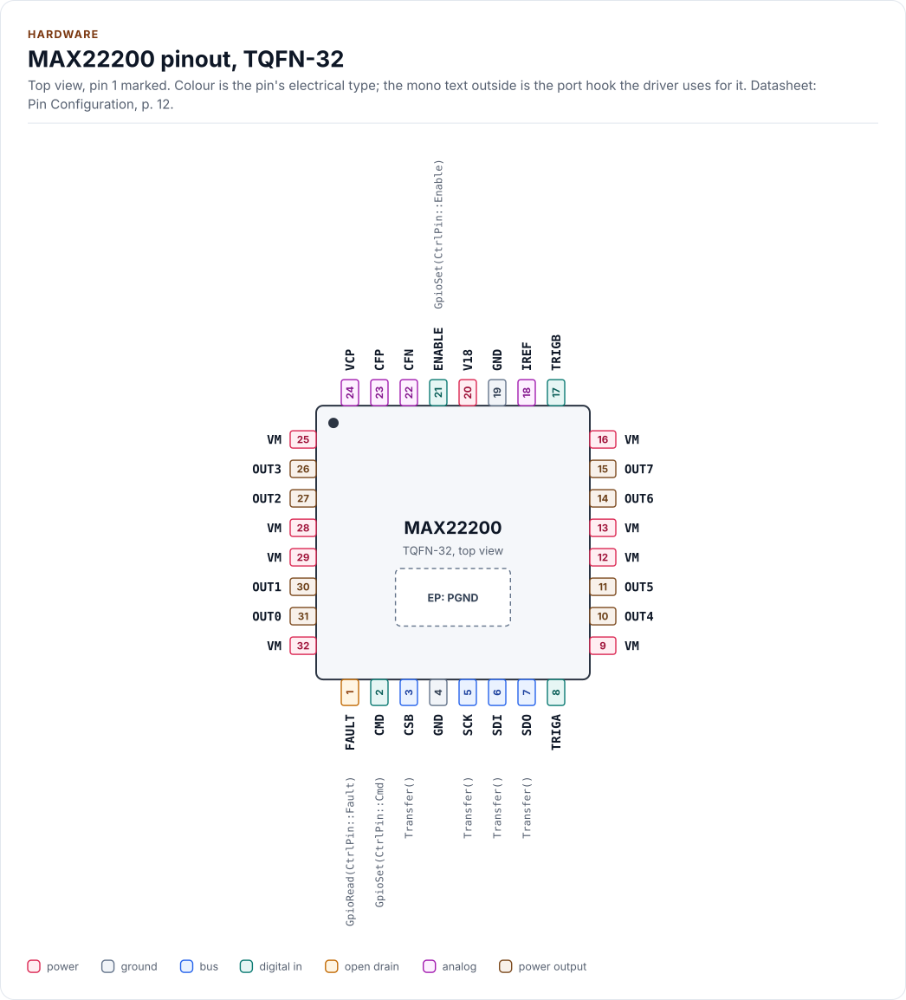
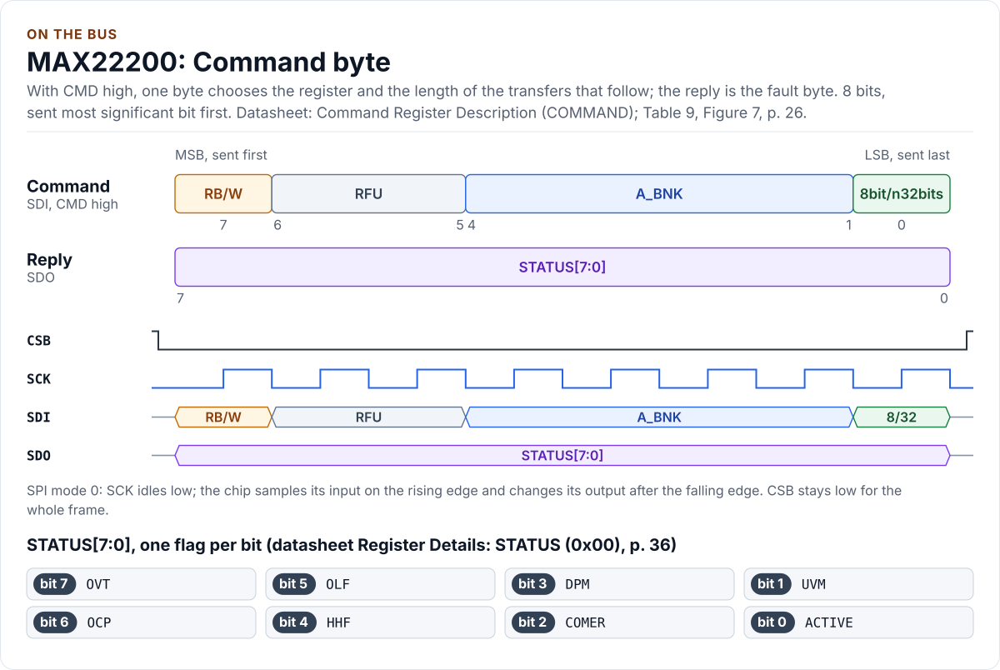
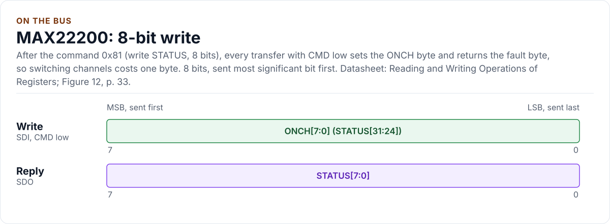
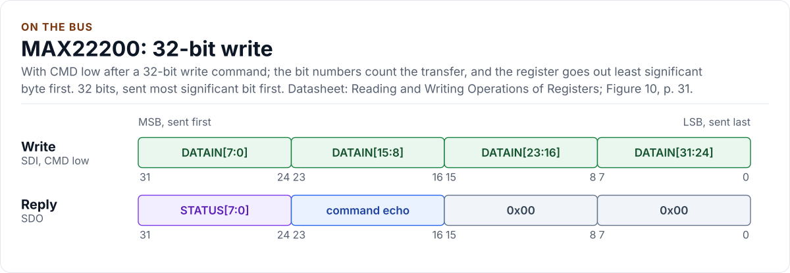

---
hide:
  - navigation
  - toc
---

<div class="kb-hero" markdown>
<span class="kb-kicker">Octal solenoid and motor driver</span>

# MAX22200 Driver

<p>A C++20 driver for the Analog Devices MAX22200 and MAX22200A octal solenoid and motor drivers. It starts the
chip with the datasheet's procedure, switches channels with one 8-bit write (one transfer per switch), programs
HIT and HOLD in milliamps or percent, and reads the faults, on any MCU.</p>

[Quickstart](quickstart.md){ .md-button .md-button--primary }
[API guide](api-guide.md){ .md-button }
[Source on GitHub](https://github.com/kokeb-labs-drivers/driver-max22200){ .md-button }
</div>

<!-- generated: chip-summary -->
The **MAX22200** is an eight-channel driver for solenoids, valves, relays and brushed DC motors: each 36 V, 1 A
half-bridge runs a HIT then HOLD sequence under current or voltage regulation, set over SPI (General Description;
Applications; Benefits and Features, p. 1).
<!-- /generated -->

<!-- figure: chip-hero -->
<picture>
  <source media="(prefers-color-scheme: dark)" srcset="diagrams/chip-hero.dark.svg">
  
</picture>
<!-- /figure -->

## What it does

<!-- figure: chip-capabilities -->
<picture>
  <source media="(prefers-color-scheme: dark)" srcset="diagrams/chip-capabilities.dark.svg">
  
</picture>
<!-- /figure -->

## Where it is used

<!-- generated: chip-uses -->
- Relay drivers
- Solenoid, valve and electromagnet drivers
- Low-side and high-side switches
- Latched (bistable) solenoid valves
- Brushed DC motors

Uses named by the datasheet (General Description; Applications; Benefits and Features, p. 1).
<!-- /generated -->

## Inside the chip

<!-- figure: chip-blocks -->
<picture>
  <source media="(prefers-color-scheme: dark)" srcset="diagrams/chip-blocks.dark.svg">
  
</picture>
<!-- /figure -->

## Pins and wiring

<!-- figure: chip-pinout -->
<picture>
  <source media="(prefers-color-scheme: dark)" srcset="diagrams/chip-pinout.dark.svg">
  
</picture>
<!-- /figure -->

<!-- figure: chip-wiring-typical -->
<picture>
  <source media="(prefers-color-scheme: dark)" srcset="diagrams/chip-wiring-typical.dark.svg">
  
</picture>
<!-- /figure -->

<!-- figure: chip-frame-command -->
<picture>
  <source media="(prefers-color-scheme: dark)" srcset="diagrams/chip-frame-command.dark.svg">
  
</picture>
<!-- /figure -->

<!-- figure: chip-frame-switch -->
<picture>
  <source media="(prefers-color-scheme: dark)" srcset="diagrams/chip-frame-switch.dark.svg">
  
</picture>
<!-- /figure -->

<!-- figure: chip-frame-write32 -->
<picture>
  <source media="(prefers-color-scheme: dark)" srcset="diagrams/chip-frame-write32.dark.svg">
  
</picture>
<!-- /figure -->

Every pin, the application circuit, the bus settings, the timing and the power: [Hardware](hardware.md).

## Quick start

Wire the chip as above, write the port ([Porting](porting.md)), then configure a channel and open the valve:

```cpp
--8<-- "tests/docs/quickstart.cpp:quickstart"
```

The steps explained: [Quickstart](quickstart.md).

## Driver coverage

<!-- generated: chip-coverage -->
| Capability | What the chip does | Driver API | Registers | Status | Datasheet |
| --- | --- | --- | --- | --- | --- |
| [Channel switching](api-guide.md) | Switches each channel on or off with one 8-bit write of the ONCH byte, no read needed | `SetChannel`, `SetChannelsOn`, `ReadChannelsOn` | `ONCH`, `STATUS` | Supported | Programming Procedure, p. 23 |
| [HIT and HOLD sequence](drive-modes.md) | Pulls a plunger in at the HIT level for a set time, then holds it at a lower level to save power | `ConfigureChannel`, `SetHoldCode`, `HitTimeCode` | `CFG_CH0`, `HIT`, `HOLD`, `HIT_T` | Supported | Functional Description - Two Levels Drive Sequence for Solenoid Valves, p. 14 |
| [CDR and VDR regulation](drive-modes.md) | Regulates the coil current against a full scale set by RREF, or the PWM duty cycle in 1 % steps (high-side drive is VDR only) | `CurrentCode`, `FullScaleUa`, `DriveMode::Cdr`, `DriveMode::Vdr`, `DutyLimitsOf` | `VDRnCDR`, `HSnLS`, `HFS` | Supported | Current Drive Regulation (CDR), p. 18 |
| [Chopping frequency and slew rate](drive-modes.md) | Sets the oscillator and each channel's chopping frequency, with slower edges for less EMI | `MasterClock`, `ChopDivider`, `ConfigureChannel` | `FREQM`, `FREQ_CFG`, `SRC` | Supported | Chopping Frequency (FREQM, FRQ_CFG_), p. 16 |
| [Parallel and full-bridge pairs](drive-modes.md) | Ties two half-bridges for twice the current, or makes an H-bridge for a latched valve or a DC motor | `SetPairMode`, `SetBridge`, `PairMode::FullBridge` | `CM10`, `CM32`, `CM54`, `CM76` | Supported | Supported Driver Configurations, p. 20 |
| [Protection and fault flags](api-guide.md) | Overcurrent, open load, HIT not reached, overtemperature, undervoltage: per-channel flags and FAULT | `ReadStatus`, `ReadFaults`, `ClearFaults`, `SetFaultMask`, `ReadFaultPin` | `STATUS`, `FAULT`, `OL_EN`, `HHF_EN`, `M_OVT` | Supported | Protection Circuits, p. 21 |
| [Detection of plunger movement](drive-modes.md) | Looks for the current dip a moving plunger makes during HIT, and flags a valve that did not move | `SetDpm`, `DpmCurrentCode` | `CFG_DPM`, `DPM_EN`, `DPM_ISTART`, `DPM_IPTH`, `DPM_TDEB` | Supported | Detection of Plunger Movement (DPM), p. 22 |
| [Trigger inputs](hardware.md) | TRIGA and TRIGB switch even and odd channels directly; the driver selects them, your code drives the pins | `ConfigureChannel`, `ChannelConfig` | `TRGnSPI` | Partial | Functional Description - Two Levels Drive Sequence for Solenoid Valves, p. 14 |
| [Daisy chain](limitations.md) | Several chips on one SPI chain at up to 5 MHz; the driver talks to one chip per object | - | - | Not covered | SPI Detailed Description, p. 23 |

**Supported**: the driver covers it and a host test checks it; **Partial**: covered in part; the coverage map says which
part; **Not covered**: the chip has it and the driver leaves it alone.

From [`docs/hardware.yml`](hardware.yml); `kokeb-docs hardware --check` confirms that every API name is in
`inc/max22200.hpp`, `inc/max22200_types.hpp` and every register in `inc/max22200_registers.hpp`.
<!-- /generated -->

The driver has no platform code. You give it a small class that moves bytes and drives CMD and ENABLE; it does the
rest: the programming procedure, the two-phase register access, the unit conversions, the read-back of every
register at start-up, and the fault registers of both parts.

- **One object per chip.** `MAX22200<YourPort>` takes a reference to your port and does no I/O until
  `EnsureInitialized()`. See [API guide](api-guide.md).
- **Errors you can act on.** Every call returns `Result<T>` with an `Error` such as `Bus`, `ChannelsActive` or
  `DeviceReset`. See [API guide](api-guide.md#handle-errors).
- **Datasheet codes, checked.** `Config{}` holds the reset values of STATUS and every channel; the conversions
  refuse a current that would round to the unregulated code and a HIT time that would round to "forever". See
  [Drive modes](drive-modes.md).
- **A fast hot path.** Switching is one 8-bit write, one transfer after another switch; a read-back is there per
  call when you want it. See [API guide](api-guide.md).
- **Zero-overhead portability.** The port is a CRTP class checked by a concept: the bus, CMD and ENABLE and a
  delay, plus optional FAULT-pin and logging hooks found at compile time. See [Porting](porting.md).
- **No heap, no exceptions, no RTTI.** The host tests build with `-fno-exceptions -fno-rtti`. See
  [Contract](contract.md).
- **Tested without hardware, and honest about it.** Host tests and a fuzzer run the driver against a protocol model
  of the chip; nothing is verified on hardware yet. See [Status and limitations](limitations.md).

## Datasheet

<!-- generated: datasheet-card -->
| Document | Revision | Get it |
| --- | --- | --- |
| Datasheet: MAX22200/MAX22200A 36V, 1A Octal Integrated Serial-Controlled Solenoid and Motor Driver (Analog Devices 19-100531) | 1, 2025-03 | [vendor page](https://www.analog.com/en/products/max22200.html) |

Written against these revisions; the SHA-256 of each file is in [`docs/datasheets.yml`](datasheets.yml). Where each part
of the driver is in the datasheet: [Datasheet map](datasheet.md).
<!-- /generated -->

## Where to go next

<div class="grid cards" markdown>

-   :material-rocket-launch-outline: **[Quickstart](quickstart.md)**

    ---

    Wire the chip, write the port, open a valve in about 20 lines.

-   :material-chip: **[Hardware](hardware.md)**

    ---

    Pins, bus settings, timing and power.

-   :material-file-document-check-outline: **[Contract](contract.md)**

    ---

    What the driver promises, what it needs, threading and errors.

-   :material-code-braces: **[API guide](api-guide.md)**

    ---

    Start, switch, configure, read faults and handle errors, task by task.

-   :material-swap-horizontal: **[Porting](porting.md)**

    ---

    Implement the port for your MCU.

-   :material-book-open-variant: **[API reference](api-reference.md)**

    ---

    Every class and member, generated from the headers.

</div>
